# CocaTrace Edge AI — Sistema de Trazabilidad y Monitoreo Inteligente

Sistema inteligente de monitoreo y trazabilidad que integra inteligencia artificial embebida (TinyML), computación en la nube con AWS y agentes conversacionales mediante MCP (Model Context Protocol).

Utiliza dos nodos físicos independientes basados en microcontroladores ESP32 que ejecutan tres modelos neuronales locales sin depender de conexión constante a internet: un nodo analiza condiciones climáticas (DHT11) y movimiento logístico (MPU6050) mediante modelos compilados con Edge Impulse EON, mientras que una ESP32-CAM realiza detección visual de plagas y estado de hojas en tiempo real con el algoritmo FOMO.

Los datos de inferencia viajan de forma segura por MQTT hacia AWS IoT Core, donde reglas SQL filtran anomalías críticas (estrés térmico, baja temperatura o presencia de hongos) para disparar notificaciones instantáneas por correo electrónico mediante Amazon SNS. Paralelamente, la telemetría histórica se almacena en DynamoDB y se visualiza en un panel web interactivo alojado en Amazon S3 con actualización cada 1.5 segundos.

Ambas placas alojan servidores HTTP JSON-RPC 2.0 directamente en su memoria RAM, permitiendo que el usuario consulte el estado actual del cultivo, historiales y alertas mediante lenguaje natural desde VS Code (GitHub Copilot Agent) sin servidores intermedios.

## Integrantes
* Valentina Arciniegas
* Davinson Tulande
* Carlos Daza
* Andres Coral

## Estructura del Repositorio

```text
cocatrace-edge-ai/
├── dataset/                        # Conjuntos de datos de entrenamiento y validación (clima, movimiento e imágenes)
│   ├── dataset temp.rar
│   ├── dataset acelerometro.rar
│   └── dataset fotos.rar
├── docs/                           # Diagramas de arquitectura, métricas de modelos y capturas de configuración AWS
├── firmware/                       # Código fuente C++ (.ino) y credenciales (credentials.h) para ESP32 y ESP32-CAM
├── .vscode/                        # Configuración de integración MCP para VS Code / GitHub Copilot Agent
├── models/                         # Librerías y modelos compilados de Edge Impulse (EON Compiler y FOMO INT8)
├── src/
│   └── lambda/
│       └── iot-backend-img/        # Función AWS Lambda en Python 3.13 para consultas concurrentes en DynamoDB
├── .gitignore                      # Exclusión de archivos temporales y credenciales sensibles
├── index.html                      # Dashboard web en tiempo real (HTML5, CSS3, JS + Chart.js) alojado en Amazon S3
└── README.md                       # Documentación técnica completa del sistema

```

## Tabla de Contenidos

- [Arquitectura](#Arquitectura)
- [1. Modelos de clasificación](#1-modelos-de-clasificación)
  - [1.1 Humedad- Temperatura](#11-humedad--temperatura)
  - [1.2 Acelerómetro](#12-acelerómetro)
  - [1.3 Cámara](#13-cámara)
- [2. Configuración ESP32 – ESP32CAM](#2-configuración-esp32--esp32cam)
  - [2.1 ESP32](#21-esp32)
  - [2.2 ESP32-CAM](#22-esp32-cam)
  - [2.3 Archivo de Configuración (config.h) esp32 / esp-cam](#23-archivo-de-configuración-configh--esp32--esp-cam)
  - [2.4 MCP](#24-mcp)
- [3. Configuración de AWS IoT Core](#3-configuración-de-aws-iot-core)
  - [3.1 Creación del objeto (Thing)](#31-creación-del-objeto-thing)
- [4. Base de datos DynamoDB](#4-base-de-datos-dynamodb)
  - [4.1 Creación de la tabla](#41-creación-de-la-tabla)
- [5 Reglas de enrutamiento](#5-reglas-de-enrutamiento)
  - [5.1 Flujo de Configuración General](#51-flujo-de-configuración-general)
  - [5.2 Resumen de las 3 Reglas y Tablas en DynamoDB](#52-resumen-de-las-3-reglas-y-tablas-en-dynamodb)
  - [5.3 observar valores de la tabla](#53-observar-valores-de-la-tabla)
- [6. Lambda](#6-lambda)
  - [6.1creación de lambda Peticiones GET](#61-creación-de-lambda-peticiones-get)
  - [6.2 Agregar desencadenador](#62-agregar-desencadenador)
- [7. Dashboard S3](#7-dashboard-s3)
  - [7.1 Index](#71-index)
  - [7.2 Dashboard](#72-dashboard)
- [8 Alertas](#8-alertas)
- [9 Retos y Posibles Mejoras Futuras](#9-retos-y-posibles-mejoras-futuras)


# Arquitectura 

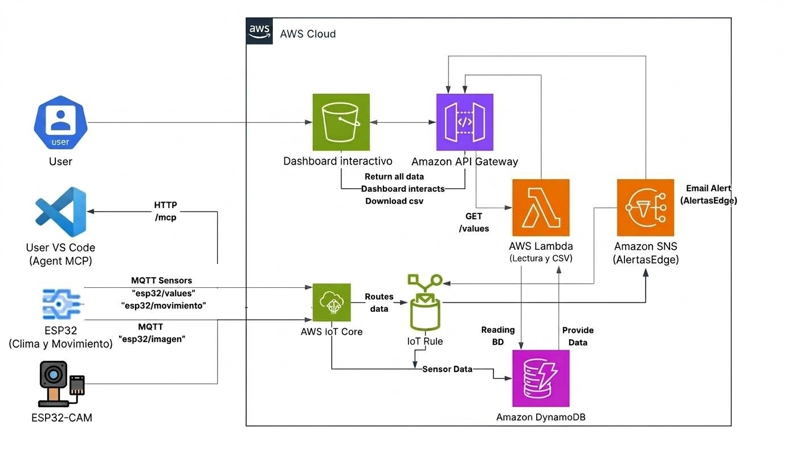

1. **Capa Edge (Inferencia Local en Microcontroladores):**

* **Nodo Principal (`ESP32`):** Ejecuta dos modelos neuronales de Edge Impulse simultáneamente:
  
    * *Modelo Climático :* Clasifica temperatura (`optimo`, `baja_temp`, `estres_termico`) a 1 Hz con sensor DHT11.
  
    * *Modelo de Movimiento:* Clasifica estados logísticos (`reposo`, `transporte`, `volteo`) a 50 Hz con acelerómetro/giroscopio MPU6050.
  
    * *Nodo de Visión (`ESP32-CAM AI-Thinker`):* Ejecuta un modelo de detección de objetos **FOMO** para identificar el estado
 de las hojas (`hoja_sana`, `seca`, `hongo`) junto con sus coordenadas espaciales `(x, y)`.

2. **Capa Cloud & Alertas (AWS Serverless):**

* **AWS IoT Core:** Recepción segura mediante MQTT sobre TLS 1.2 (`esp32/values`, `esp32/movimiento`, `esp32/imagen`).
 
* **Reglas IoT + Amazon SNS:** Filtrado SQL en tiempo real para el disparo automático de alertas personalizadas por correo electrónico ante anomalías térmicas, manipulación brusca o detección de plagas.
  
* **Amazon DynamoDB + AWS Lambda + API Gateway**: Persistencia histórica de telemetría y exposición de endpoints REST para consulta unificada.
* **Amazon S3 (Dashboard Web):** Interfaz interactiva con actualización asíncrona cada 1.5 segundos, gráficas dinámicas (Chart.js) y exportación a CSV. 

3. **Ambas placas ESP32 alojan un servidor HTTP JSON-RPC 2.0 (`/mcp`) con búferes circulares en RAM (últimos 10 registros por modelo), permitiendo consultas en lenguaje natural directamente desde **VS Code (GitHub Copilot Agent)** sin intermediarios.**

## 1. Modelos de clasificación 

### 1.1 Humedad- Temperatura

Este modelo neuronal se entrena y compila con **Edge Impulse (EON Compiler)** para operar directamente sobre el microcontrolador **ESP32** (`tflite_learn_1171835_5`), permitiendo detectar anomalías térmicas en tiempo real sin depender de procesamiento en la nube. (sensor DHT11).Las metricas obtenidas son:


* **Precisión y Pérdida:** El modelo alcanzó un **100.0 % de exactitud (*Accuracy*)** y una **pérdida (*Loss*) de 0.00** sobre el conjunto de validación, demostrando una convergencia óptima sin errores de clasificación.
  
* **Matriz de Confusión:** Las tres clases (`baja_temp`, `estres_termico` y `optimo`) obtuvieron un **F1-Score de 1.00** (100 % de aciertos en la diagonal principal y 0 % de falsos positivos/negativos entre categorías).
  
* **Separabilidad de Características (*Data Explorer*):** En la proyección del espacio de características, los clústeres de cada estado térmico aparecen claramente diferenciados y sin solapamiento, lo que explica el **AUC-ROC de 1.00** y garantiza inferencias determinísticas y estables en el ESP32.

El dataset de entrenamiento y validación se encuentra en `dataset/dataset temp.rar`

### 1.2 Acelerómetro

Este modelo neuronal se entrena y compila con **Edge Impulse** (`Acelerometro_esp32_inferencing`) sobre el nodo principal **ESP32**, permitiendo supervisar la manipulación física y el estado logístico de las bandejas o contenedores del cultivo en tiempo real. (sensor MPU6050), las metricas obtenidas son:

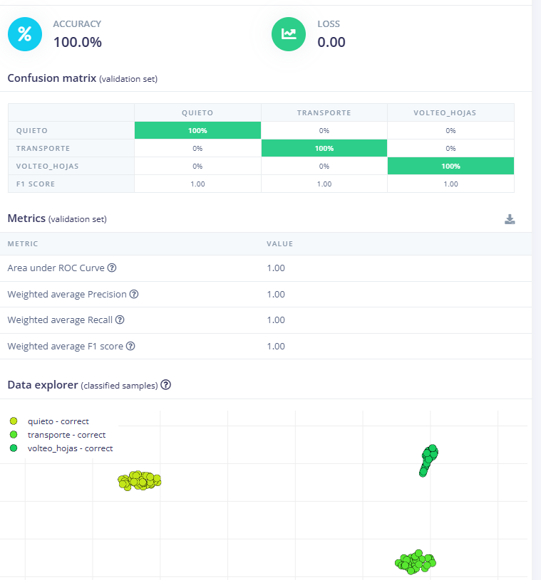

* **Precisión y Pérdida:** El modelo alcanzó un **100.0 % de exactitud (*Accuracy*)** y una **pérdida (*Loss*) de 0.00** sobre el conjunto de validación, confirmando una convergencia óptima en la clasificación de patrones inerciales.
  
* **Matriz de Confusión:** Las tres clases (`quieto`, `transporte` y `volteo_hojas`) obtuvieron un **F1-Score de 1.00** (100 % de aciertos en la diagonal principal y 0 % de falsos positivos o confusión entre eventos).
  
* **Separabilidad de Características (*Data Explorer*):** En la visualización espectral de muestras clasificadas, los tres clústeres (`quieto`, `transporte` y `volteo_hojas`) se agrupan de forma compacta y completamente aislada entre sí, respaldando el **AUC-ROC de 1.00** y asegurando detecciones confiables en tiempo real sobre el MPU6050.

El dataset de entrenamiento y validación se encuentra en `dataset/dataset acelerometro.rar`

### 1.3 Cámara

Este modelo de detección de objetos fue entrenado en **Edge Impulse** utilizando la arquitectura **FOMO (*Faster Objects, More Objects*)** (`Train-Esp32cam_inferencing`) y desplegado sobre un nodo independiente **ESP32-CAM**, permitiendo inspeccionar visualmente el estado fitosanitario de las hojas del cultivo en tiempo real y localizar espacialmente posibles anomalías.

Para construir el dataset, se desplegó un servidor HTTP local en la ESP32-CAM AI-Thinker que transmitía video en vivo por red local hacia el navegador (http://<IP_ESP32_CAM>), permitiendo ajustar la exposición/resolución del sensor OV2640 y guardar las capturas (Get Still) directamente desde el lente real. la interfaz es:


Las metricas que se obtuvieron son:

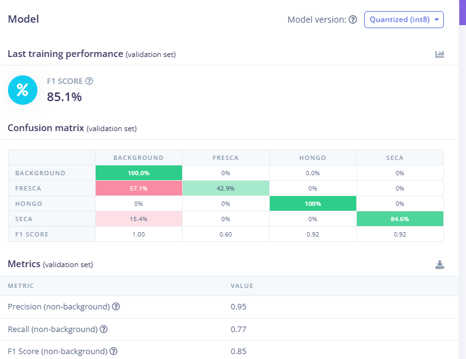

* **Precisión y Métricas Globales :** El modelo cuantizado alcanzó un **F1-Score global de 85.1 %** (`0.85` en clases *non-background*), con una **precisión (Precision) de 0.95** y una **sensibilidad (Recall) de 0.77** sobre el conjunto de validación, minimizando falsas alarmas durante la inferencia en tiempo real en la ESP32-CAM.

*  **Matriz de Confusión:** Las alertas críticas **`HONGO`** (`100 %` de aciertos) y **`SECA`** (`84.6 %` de aciertos) alcanzaron un **F1-Score de 0.92**, presenta errores al momento de distinguir la hoja `FRESCA` con el background, esto  no genera falsas alarmas ni disparos erróneos en AWS SNS, porque nunca se confunde con HONGO ni con SECA — ambas columnas tienen 0 % de error cruzado.
  
* **Desempeño por Clase en Borde:** La alta precisión en las anomalías fitosanitarias (`HONGO` y `SECA`) asegura detecciones confiables en tiempo real sobre el sensor OV2640 sin disparar falsos positivos cuando no hay follaje en el encuadre.

El dataset de entrenamiento y validación se encuentra en `dataset/dataset fotos.rar`

## 2. Configuración ESP32 – ESP32CAM

### 2.1 ESP32

Este nodo ejecuta de manera concurrente dos modelos de aprendizaje automático compilados desde **Edge Impulse** y gestiona tanto la telemetría segura hacia la nube como el servidor local MCP.

* **Sensores y Conexiones:**

* **DHT11 (Clima):** Conectado al pin digital `GPIO 19` para muestreo de temperatura (°C) y humedad relativa (%) a **1 Hz**.

* **MPU6050 (IMU de 6 ejes):** Conectado por bus I2C (`SDA: GPIO 21`, `SCL: GPIO 22`), configurado con rango de aceleración y giroscopio  a `21 Hz` con muestreo a **50 Hz**.

Al arrancar el microcontrolador, se ejecutan cuatro rutinas críticas en secuencia: 

1. **Sensores:** Inicia el sensor digital **DHT11** en `GPIO 19` y el bus I2C (`SDA: GPIO 21`, `SCL: GPIO 22`) para comunicarse con el **MPU6050**, configurando su rango dinámico para aceleración y giroscopio, activando el filtro digital pasa-bajos (DLPF) a `21 Hz` para mitigar vibraciones mecánicas de alta frecuencia. 

2. **Asignación de Tensores EON (`iniciarModeloClima`):** Inicializa el grafo neuronal compilado (`tflite_learn_1171835_5_init`) reservando memoria dinámica en heap (`ei_calloc`) y enlazando los punteros directos a los tensores de entrada (`input_clima`) y salida (`output_clima`).

3. **Red Wi-Fi y Reloj NTP (`conectarWiFi`):** Establece conexión en modo estación (`WIFI_STA`) con potencia de transmisión ajustada a `11 dBm` para evitar picos de corriente que afecten al DHT11, y sincroniza el reloj interno mediante servidores NTP (`pool.ntp.org`, `time.nist.gov`) en zona horaria **UTC-5** para generar marcas de tiempo ISO-8601 (`YYYY-MM-DDTHH:MM:SS-05:00`).

4. **Servidores de Comunicación (`iniciarServidorMCP` y `conectarAWS`):** Levanta el servidor HTTP en el puerto `80` (endpoint `/mcp`) y realiza el *handshake* TLS 1.2 contra el endpoint de **AWS IoT Core** (puerto `8883`) utilizando certificados X.509 (`AWS_CERT_CA`, `AWS_CERT_CRT`, `AWS_CERT_PRIVATE`).

#### Bucle Principal Asíncrono (`loop`) 

Para evitar que operaciones de red o inferencia bloqueen el muestreo de alta frecuencia, el `loop()` evita el uso de `delay()` y se divide en dos lazos temporizados mediante `millis()`:

* A. Pipeline de Movimiento Inercial (50 Hz — `INTERVALO_MOV_MS = 20 ms`)
  
    * **Adquisición:** Cada 20 milisegundos lee los 6 ejes del MPU6050 (a_x, a_y, a_z, g_x, g_y, g_z) y los apila secuencialmente en `buffer_mov`.

    * ***Inferencia:** Al completar una ventana deslizante de **2 segundos** (`EI_CLASSIFIER_DSP_INPUT_FRAME_SIZE` = 600 floats), invoca `run_classifier()` a través del callback `get_data_mov`.
  
    * **Publicación:** Extrae la clase ganadora (`quieto`, `transporte` o `volteo_hojas`), redondea la probabilidad a 3 decimales, actualiza la memoria local y serializa un payload JSON de 512 bytes hacia el tópico `esp32/movimiento`.
 
El Json que se publica en AWS es:

```bash
json
 { "timestamp": 1793859932,
"id_sensor": "ESP32",
"temperatura": 23.8,
"humedad": 50.8,
"lote": "LOTE-2026-01",
"proceso": "SECADO" }
"model_mov": "quieto",
"confianza": 0.962,
"ax": 0.12, 
"ay": -0.05, 
"az": 9.78,
"gx": 0.01,
"gy": -0.02, 
"gz": 0.00
}
```
  
* B. Pipeline Climático (1 Hz — `INTERVALO_CLIMA_MS = 1000 ms`)

    * **Adquisición y Preprocesamiento:** Cada segundo lee temperatura ($^\circ\text{C}$) y humedad ($\%$) del DHT11. Si la lectura es válida (`!isnan(t)`), multiplica la temperatura por el factor de normalización `ESCALA_TEMP = 0.025f` y almacena 3 muestras consecutivas en `buffer_clima`.
      
    * **Inferencia EON Agnostic-Type:** Al completar 3 segundos, copia los valores al tensor de entrada soportando automáticamente tanto modelos en punto flotante (`kTfLiteFloat32`) como modelos cuantizados de 8 bits (`kTfLiteInt8`, aplicando escala y *zero-point*), ejecuta `tflite_learn_1171835_5_invoke()` y obtiene la predicción (`baja_temp`, `estres_termico` u `optimo`) para publicarla en `esp32/values`.

El Json que se publica en AWS es:

```bash
json
 {
"timestamp": 1793859932,
"id_sensor": "ESP32",
"temperatura": 23.8,
"humedad": 50.8,
"lote": "LOTE-2026-01",
"proceso": "SECADO" 
"model_temp": "optimo",
"confianza": 0.985
}
```
* **Resolución de Colisión de Librerías Edge Impulse (EON Compiler):** Al intentar integrar dos librerías estándar exportadas desde **Edge Impulse** en un mismo *sketch* de Arduino IDE (Movimiento y Clima), el compilador arroja errores de definición múltiple (*multiple definition*) debido a que cada librería empaqueta su propia instancia global del SDK (`edge-impulse-sdk` y el intérprete de TensorFlow Lite Micro).
  
Se mantuvo la librería completa de Edge Impulse para el modelo de movimiento (`Acelerometro_esp32_inferencing.h`), mientras que el segundo modelo (Clima) fue exportado como código C++ puro compilado con **EON Compiler** `tflite_learn_1171835_5_compiled.h`), invocando directamente sus funciones estáticas (`init`, `input`, `output`, `invoke`) y reutilizando el *runtime* compartido del primer SDK sin duplicar dependencias ni saturar la memoria Flash del ESP32.

#### Servidor MCP Embebido

El firmware mantiene el estado vivo del sistema sin depender de tarjetas SD ni consultas a la nube

* Define las estructuras `RegistroClima` y `RegistroMov` junto con arreglos estáticos de 10 posiciones (`histClima[10]` y `histMov[10]`).

* Cada nueva inferencia ejecuta `guardarHistorialClima()` o `guardarHistorialMov()`, desplazando los elementos existentes una posición hacia atrás e insertando el registro más reciente en el índice `0`.

El microcontrolador expone una API compatible con **Model Context Protocol (MCP)** sobre `HTTP POST /mcp` y envia información de las `tools`.

### 2.2 ESP32-CAM

El nodo de visión artificial está diseñado para ejecutar inferencia espacial en tiempo real sobre la placa **ESP32-CAM (AI-Thinker)** utilizando el modelo de detección de objetos **FOMO (*Faster Objects, More Objects*)** compilado con Edge Impulse (`Train-Esp32cam_inferencing.h`), integrando telemetría segura hacia AWS IoT Core y un servidor local del protocolo MCP.

Dado que el procesamiento de imágenes requiere bloques continuos de memoria que superan la SRAM interna del microcontrolador, el firmware explota la **PSRAM externa de 4 MB** integrada en el módulo AI-Thinker: 

* **Mapeo del Sensor Óptico (`OV2640`):** Define los pines dedicados del bus paralelo de cámara (`D0–D7`, `VSYNC`, `HREF`, `PCLK`, `XCLK` a `20 MHz`) y el bus SCCB/I2C (`SIOD: GPIO 26`, `SIOC: GPIO 27`).

* **Gestión de Framebuffer (`camera_config`):** Configura la captura nativa en formato comprimido `PIXFORMAT_JPEG` a resolución `QVGA (320x240)` con calidad `12` y aloja el *framebuffer* directamente en memoria externa (`CAMERA_FB_IN_PSRAM`) bajo modo `CAMERA_GRAB_WHEN_EMPTY` para garantizar siempre el fotograma más reciente sin latencia acumulada. 

En cada ciclo de ejecución, el microcontrolador realiza cuatro etapas secuenciales de visión por computadora: 

1. **Reserva Dinámica y Captura (`ei_camera_capture`):** Asigna dinámicamente en memoria un búfer de trabajo (`snapshot_buf` de `320 × 240 × 3` bytes) y obtiene el fotograma JPEG desde el sensor (`esp_camera_fb_get`).

2. **Decodificación y Reescalado (`DSP`):**

* Convierte el fotograma comprimido de **JPEG a RGB888** crudo mediante `fmt2rgb888()` y libera inmediatamente el *framebuffer* de hardware (`esp_camera_fb_return`) para evitar fugas de memoria.

* Si las dimensiones de entrada de la red neuronal difieren de `320x240`, aplica recorte e interpolación bilineal en sitio mediante `ei::image::processing::crop_and_interpolate_rgb888()`.

3. **Empaquetado de Tensores (`ei_camera_get_data`):** Convierte cada píxel de 3 bytes `(R, G, B)` en un entero empaquetado de 24 bits en punto flotante (`(R << 16) + (G << 8) + B`) requerido por el SDK de Edge Impulse, ejecutando posteriormente la red neuronal con `run_classifier()`.

4. **Filtrado de Centroides FOMO (`EI_CLASSIFIER_OBJECT_DETECTION`):**

* Recorre todas las cajas delimitadoras/centroides (`bounding_boxes`) devueltos por FOMO y selecciona la detección con mayor nivel de confianza (`max_val`).

* Aplica un **umbral de confianza mínima de `0.65` (65%)** y un control de tasa de envío (`interval = 2000 ms`) antes de registrar y publicar el evento (`publishDetection`), evitando falsos positivos y saturación de mensajes MQTT.

Al igual que el nodo principal, la ESP32-CAM opera con doble canal de salida simultáneo: 

* **Telemetría Segura a AWS IoT Core:** Se autentica mediante certificados X.509 (`TLS 1.2`) en el puerto `8883` y publica los resultados clasificados (`hoja_sana`, `seca` u `hongo`) junto con sus coordenadas `(x, y)` en el tópico `esp32/imagen`.

El Json que se publica en AWS es:

```bash
json
 { 
  "timestamp": 1793859932,
  "id_sensor": "ESP32_CAM_01",
  "estado_hoja": "hoja_sana",
  "confianza": 0.914,
  "x": 48,
  "y": 52,
  "lote": "LOTE-2026-01",
  "proceso": "SECADO"
}
```

#### Servidor MCP Embebido

Levanta un servidor web HTTP JSON-RPC 2.0 en el puerto `80` (`/mcp`) que atiende peticiones de **VS Code (GitHub Copilot Agent)** mediante `mcpServer.handleClient()`: 

* Implementa la estructura `RegistroHoja` (almacenando `estado_hoja`, `confianza`, coordenadas espaciales `x, y` y marca de tiempo ISO-8601 sincronizada vía NTP en UTC-5).
  
* Cada detección válida ejecuta `guardarHistorialHoja()`, desplazando los registros anteriores en el arreglo `historialHoja[10]` e insertando el evento más reciente en el índice `0`.

permite consultas históricas inmediatas desde agentes de IA sin depender de tarjetas microSD ni consultas a la base de datos en la nube.

### 2.3 Archivo de Configuración (config.h)  esp32 / esp-cam

Se crea el archivo llamado `config.h` para las claves de red Wi-Fi y los certificados TLS X.509 de AWS IoT Core, en este archivo  debe incluir.

. Las variables de entorno para la red local (`WIFI_SSID`, `WIFI_PASSWORD`).

2. El **Endpoint de AWS IoT Core**, los tópicos MQTT y el contenido textual de los certificados descargados (`AmazonRootCA1.pem`, `xxxx-certificate.pem.crt` y `xxxx-private.pem.key`) utilizando la sintaxis `PROGMEM R"EOF(...)EOF"`.

Se puede observar más a detalle en `firmware/credentials.h`

Los tres modelos utilizados se encuentran en: `models`

### 2.4 MCP

ambos nodos levantan un servidor HTTP ligero (`WebServer.h`) en el puerto `80` bajo el endpoint `/mcp`, implementando el estándar **JSON-RPC 2.0** (versión de protocolo `2024-11-05`) con soporte de cabeceras CORS y respuestas estructuradas en texto/JSON

* **Negociación Inicial (method: "initialize"):** El microcontrolador responde declarando compatibilidad con el protocolo 2024-11-05, anunciando su capacidad de ejecución de herramientas ("capabilities": { "tools": {} }) e identificándose (esp32-invernadero-mcp v1.1.0 o esp32-cam-vision-mcp v1.0.0).
  
* **Descubrimiento de Herramientas (method: "tools/list"):** Cada ESP32 devuelve el catálogo de funciones disponibles junto con su inputSchema en formato JSON Schema, permitiendo que el LLM entienda qué hace cada herramienta y cuándo invocarla de forma autónoma.
  
* **Ejecución Remota (method: "tools/call"):** El agente envía el nombre de la herramienta (params.name), el microcontrolador lee directamente sus variables globales o sus arreglos circulares en SRAM (histClima, histMov, historialHoja) y devuelve el resultado empaquetado dentro de result.content[0].text.

las `tools` implementadas son:

| Nodo Físico | Servidor MCP | Herramienta (`tools/call`) | Parámetros | Función y Datos Devueltos desde RAM |
| :--- | :--- | :--- | :--- | :--- |
| **ESP32 Principal** (`esp32-cocatrace`) | `esp32-invernadero-mcp` (`v1.1.0`) | `obtener_estado_actual` | *Ninguno* | Temperatura (°C), humedad (%), 6 ejes IMU (`ax`, `ay`, `az`, `gx`, `gy`, `gz`), predicciones activas y confianza. |
| **ESP32 Principal** (`esp32-cocatrace`) | `esp32-invernadero-mcp` (`v1.1.0`) | `obtener_ultimos_registros` | `cantidad` *(opcional, máx. 10)* | Búfer circular FIFO en RAM con los **últimos 10 registros** de clima y movimiento. |
| **ESP32 Principal** (`esp32-cocatrace`) | `esp32-invernadero-mcp` (`v1.1.0`) | `verificar_alertas_cultivo` | *Ninguno* | Diagnóstico inmediato en el borde sobre `estres_termico`, `baja_temp`, `transporte` o `volteo`. |
| **ESP32-CAM** (`ESP32_CAM`) | `esp32-cam-vision-mcp` (`v1.0.0`) | `obtener_estado_hoja` | *Ninguno* | Última clasificación FOMO (`hoja_sana`, `seca`, `hongo`), confianza y coordenadas `(x, y)`. |
| **ESP32-CAM** (`ESP32_CAM`) | `esp32-cam-vision-mcp` (`v1.0.0`) | `obtener_historial_camara` | `cantidad` *(opcional, máx. 10)* | Búfer circular FIFO en RAM con las **últimas 10 detecciones visuales** del sensor OV2640. |

Para conectar ambos microcontroladores al modo Agente de GitHub Copilot, se crea el archivo `vscode/mcp.json` en la raíz del repositorio apuntando a las direcciones IP asignadas por el router local:

```bash
{
  "servers": {
    "esp32-invernadero": {
      "type": "http",
      "url": "[http://192.168.1.100/mcp](http://192.168.1.100/mcp)"
    },
    "esp32-cam-vision": {
      "type": "http",
      "url": "[http://192.168.1.101/mcp](http://192.168.1.101/mcp)"
    }
  }
}
```

## 3. Configuración de AWS IoT Core

AWS IoT Core actúa como el *broker* MQTT central que permite la comunicación segura y bidireccional entre el ESP32, las funciones Lambda y el Dashboard Web.

### 3.1 Creación del objeto (Thing)

Un objeto de IoT es una representación digital de su dispositivo físico en la nube, para crear un objeto se realiza le siguiente proceso:

1. Ir a la consola de `AWS IoT core `  > `Administrar ` >`todos los dispositivos ` > `Objetos `

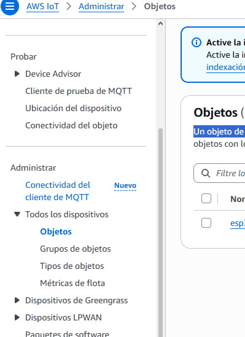

2. Se debe hacer click en la opción `crear objetos ` > `crear un único objeto`

3. En las propiedades del objeto se define el nombre del objeto ej: ` esp32-cocatrace` > siguiente

4. En la parte de certificados, seleccionar `Generar automáticamente un certificado nuevo`> siguiente

5. seleccionar la opción `crear politica`, se despliega una nueva ventana llamada `crear politica`

6. Se asigna un nombre de la política ej `esp32-cocatrace-policy`

7. Se deben asignar los documentos de política, indica de manera estructurada quién puede hacer qué, sobre qué recurso y bajo qué condiciones. En este caso el dispositivo esp32.
  
Se crea lo siguiente

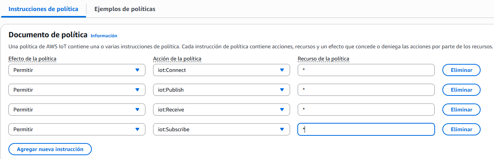

* las política sirven para otorgar permisos de conexión, publicación y suscripción al ESP32

* El uso * es para que estas políticas sirvan en cualquier recurso.

8.  Se crean las políticas > en la pestaña anterior se debe verificar que las políticas estén asociadas al objeto > se crea el objeto.

9. Se generan los certificados y claves, los certificados que se deben descargar son:
    
* **Certificado del dispositivo** (`xxxx-certificate.pem.crt`).
  
* **Clave privada** (`xxxx-private.pem.key`).
  
* **Certificado raíz de Amazon CA1** (`AmazonRootCA1.pem`).

Una vez creado el objeto > dar click al nombre del objeto > certificados > click en el nombre del certificado > políticas 

En caso de no tener políticas adjuntar política > buscar el nombre de la política creada

10. tambien se debe guardar el `end-point` este se ubica en

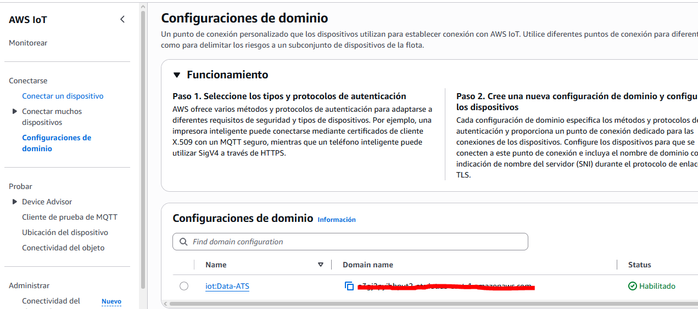

Se realiza el mismo procedimiento pero esta vez con el THING `esp32-camera` para la conexión del esp32-cam

## 4. Base de datos DynamoDB

Se utiliza como la base de datos NoSQL gestionada e independiente de servidores (*serverless*) para almacenar el historial de lecturas provenientes del `sensor DHT11`, `sensor MPU6050` y `esp32-cam`.
### 4.1 Creación de la tabla

Para crear la tabla de almacenamiento se realiza le siguiente proceso:

1. Ir a la consola de `DinamoDB `  > `Tablas ` > `crear tabla `.

2. Se debe asigna el nombre de la tabla ej `valores-sensor-dht11`.
   
3. la clave de partición es el atributo principal que identifica a un elemento y determina en qué servidor o partición física de almacenamiento se guardan sus datos. Esta se configura de la siguiente manera:

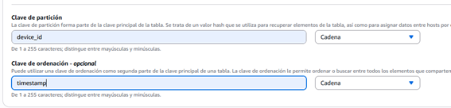

* **Clave de partición (Partition Key):** `device_id` (`String` / Cadena) :Actúa como el identificador único del dispositivo IoT (ej. `"ESP32"`). Se utiliza mediante una función hash para asignar físicamente los datos entre los distintos nodos de almacenamiento de AWS.
  
* **Clave de ordenación (Sort Key):** `timestamp` (`String` / Cadena) :Segunda parte de la clave principal compuesta. Permite registrar múltiples mediciones para un mismo `device_id` y ordenarlas o consultarlas cronológicamente.

Este procedimiento se hace para cada tabla, las tablas que se obtienen son :

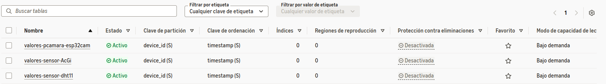

## 5 Reglas de enrutamiento

Para que los mensajes publicados por los nodos **ESP32** y **ESP32-CAM** se almacenen automáticamente en bases de datos NoSQL sin necesidad de servidores intermedios (*serverless*), se configuran **tres reglas independientes** en el motor de reglas de **AWS IoT Core** (una por cada tópico MQTT). 

### 5.1 Flujo de Configuración General 

1. Ingresar a la consola de **AWS IoT Core** > **Enrutamiento de mensajes** (*Message routing*) > **Reglas** (*Rules*) > **Crear regla** (*Create rule*).
  
2. Asignar un nombre descriptivo a la regla según el flujo de datos (por ejemplo: `save_clima_dynamodb`, `save_movimiento_dynamodb` y `save_imagen_dynamodb`).
   
3. Configurar la consulta SQL para interceptar y extraer los campos del mensaje JSON:

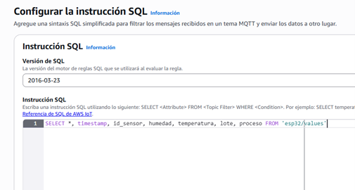 

* `SELECT *`: Selecciona y extrae automáticamente todas las claves del payload JSON enviado por el microcontrolador.
  
* `FROM '<topico_mqtt>'`: Define el tópico MQTT de origen que el motor de reglas escuchará en tiempo real (`esp32/values`, `esp32/movimiento` o `esp32/imagen`).
  
* Mapeo de atributos (`timestamp`, `device_id` / `id_sensor`, etc.): Garantiza que las claves de primer nivel estén disponibles para indexar la **Partition Key** y la **Sort Key** al insertar en DynamoDB.
  
4. Asignar la acción **DynamoDB** a la regla creada:
    
 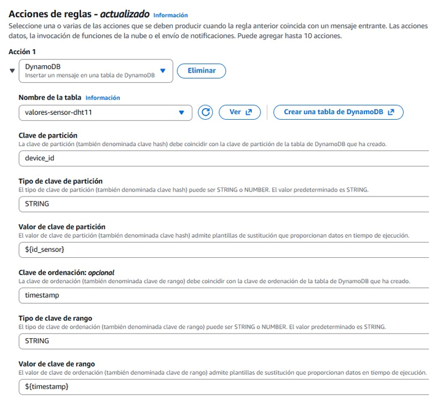

* **Clave de partición (*Partition Key*):** `${device_id}` o `${id_sensor}` *(extrae dinámicamente en tiempo de ejecución el identificador del nodo desde el JSON procesado)*.
  
* **Clave de ordenamiento (*Sort Key*):** `${timestamp}` *(extrae la marca de tiempo ISO-8601 o UNIX enviada por el microcontrolador para ordenar cronológicamente los registros)*.
  
* **Escribir datos del mensaje en esta columna:** Configurar una columna de payload (ej. `payload`) para guardar el documento JSON completo con las lecturas y predicciones de IA.

5. En **Rol de IAM**, asignar el rol **`LabRole`** (con permisos de escritura sobre DynamoDB) y finalizar la creación de la regla. 

 ### 5.2 Resumen de las 3 Reglas y Tablas en DynamoDB 

| Regla en AWS IoT Core | Tópico MQTT (`FROM`) | Tabla Destino en DynamoDB | Partition Key (`device_id`) | Sort Key (`timestamp`) | Datos Almacenados |
| :--- | :--- | :--- | :--- | :--- | :--- |
| **1. Clima** (`save_clima_dynamodb`) | `esp32/values` | `valores-sensor-temp` | `esp32-cocatrace` (`${device_id}`) | `${timestamp}` | Temperatura, humedad, lote, proceso, predicción EON (`optimo`, `baja_temp`, `estres_termico`, `riesgo_hongo`) y confianza. |
| **2. Movimiento** (`save_movimiento_dynamodb`) | `esp32/movimiento` | `valores-sensor-AcGi` | `esp32-cocatrace` (`${device_id}`) | `${timestamp}` | Predicción IMU (`quieto`, `transporte`, `volteo_hojas`), confianza y 6 ejes ($a_x, a_y, a_z, g_x, g_y, g_z$). |
| **3. Visión** (`save_imagen_dynamodb`) | `esp32/imagen` | `valores-pcamara-esp32cam` | `ESP32_CAM` (`${id_sensor}`) | `${timestamp}` | Clasificación FOMO (`hoja_sana`, `seca`, `hongo`), confianza y coordenadas del centroide `(x, y)`. |

### 5.3 observar valores de la tabla

Para ver los registros guardados se hace el siguiente proceso:

1. En  la consola de `DinamoDB `  > explorar elementos.
   
2. se ubica el nombre de la tabla  > opción Examen > ejecutar.

## 6. Lambda

El backend de la aplicación utiliza funciones **AWS Lambda** escritas en Python 3.x para procesar las peticiones HTTP/REST provenientes del Dashboard web a través de **API Gateway**.

Lambda actúa como el procesador intermedio (el "cerebro" del backend) que conecta el Dashboard web alojado en S3 con los servicios de AWS (DynamoDB y AWS IoT Core).

### 6.1 creación de lambda Peticiones GET

1. en la consola de `lambda `  > create event function

2. se asigna el nombre la función ej `iot-backend-img

3. se elije la version ejecutable en este caso Python 3.13

4. En la opción de configuración personalizada > configuración adicional > se activa -rol de ejecución personalizada > labrole
   
5. se crea el `lambda `
    
6. se crea una nueva ventana con varias opciones > codigo
    
Se crea el codigo de la función lamba

Esta función Lambda actúa como la API de lectura (método `GET`) invocado por el Dashboard web, funciona de la siguiente manera:

* **Consultas Concurrentes (`ThreadPoolExecutor`):** Ejecuta 3 hilos en paralelo para consultar simultáneamente las tablas `valores-pcamara-esp32cam`, `valores-sensor-temp` y `valores-sensor-AcGi`, minimizando la latencia de respuesta.

* **Indexación Descendente (`ScanIndexForward=False`):** Utiliza `query()` sobre la *Partition Key* (`device_id`: `ESP32_CAM` y `esp32-cocatrace`) ordenando por `timestamp` de forma descendente para recuperar los últimos registros de cada sensor.

* **Normalización de Payloads (`desempaquetar_item` y `DecimalEncoder`):** Aplana automáticamente los atributos encapsulados por las reglas de IoT Core (`STRING` / `payload`), convierte tipos `Decimal` de DynamoDB a tipos nativos JSON (`int`/`float`), soporta filtrado dinámico por parámetro `?lote=` e incluye cabeceras **CORS** habilitadas.

El codigo completo se puede observar en `src/lambda/iot-backend-img`.

Se lanza el codigo en `prod`

### 6.2 Agregar desencadenador

Se utiliza **Amazon API Gateway** para exponer una interfaz REST pública que permite al Dashboard web para consumir los datos guardados.

1. se da en la opción + agregar desencadenador, las opciones que se usan son:

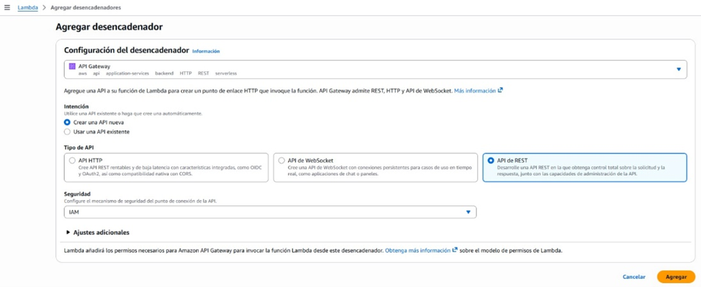

2.Luego se da a la opción agregar para activarla con la lambda anteriormente creado

3. en la consola de `Gateway de API` > crear recurso
   
4. se usan los siguientes detalles

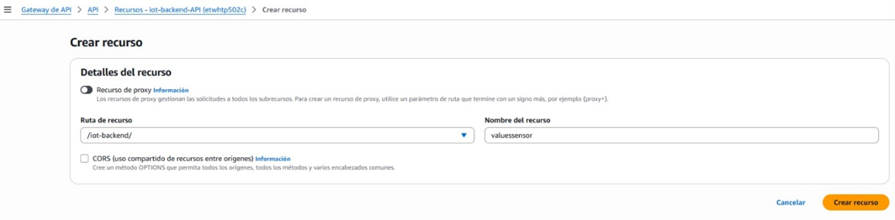

5. En la pestaña principal > crear método
   
6. tipo de método > GET > función de Lambda
   
7. se activa la opción `integración de proxy de lambda`
   
8. función de lambda > `iot-backend-img`> crear

En la pagina principal

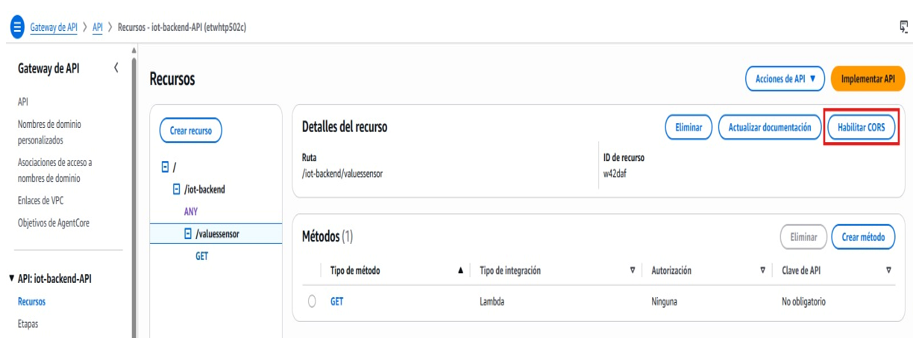

luego

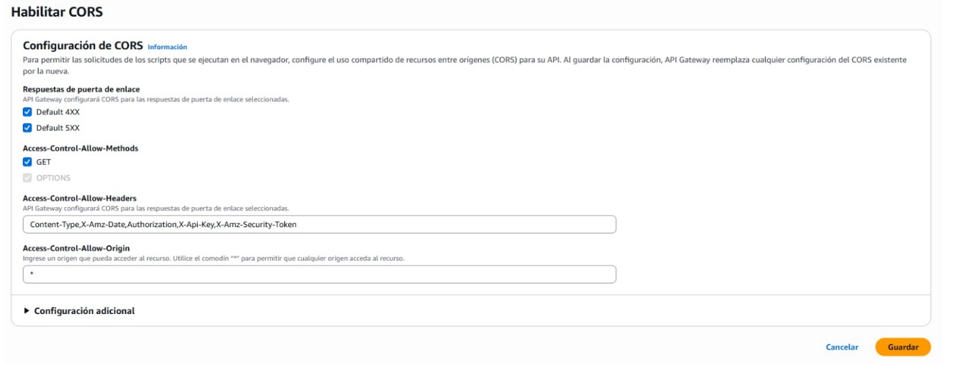

Luego se implementa el api en etapa `prod`

## 7. Dashboard S3

Amazon S3 (Simple Storage Service) es el servicio de almacenamiento de objetos en la nube que ofrece AWS. Está diseñado para guardar y recuperar cualquier cantidad de datos desde cualquier lugar de Internet con alta disponibilidad, seguridad y durabilidad.

Para crear el bucket se realiza el siguiente proceso:

1. En la consola de `Amazon S3` > crear bucket
 
2. Se agrega el nombre del bucket ej `dashboard-iot-2026-complete`

3.  Se concede acceso público a los buckets y objetos de la siguiente manera:

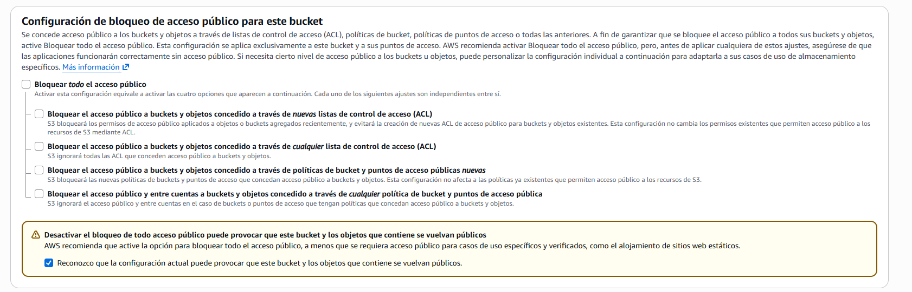
   
Se crea el bucket

4. Despues de crear el bucket > `propiedades`
   
5. Se configura`index.html` como documento índice de inicio de la siguiente manera

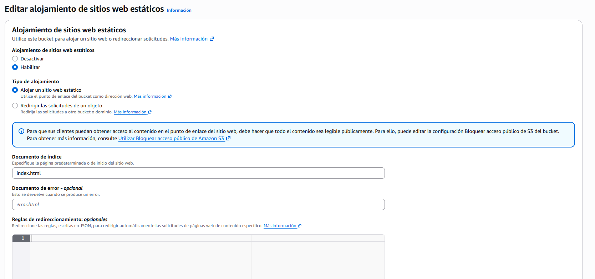

6. En `permisos` se realiza lo siguiente:

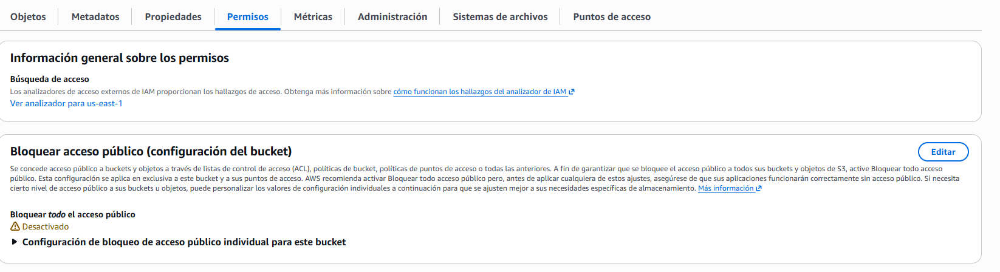

7. Se añade la siguiente politca de Bucket para permitir lectura pública

```bash
{
    "Version": "2012-10-17",
    "Statement": [
        {
            "Sid": "PublicReadGetObject",
            "Effect": "Allow",
            "Principal": "*",
            "Action": "s3:GetObject",
            "Resource": "arn:aws:s3:::tu-nombre-de-bucket/*"
        }
    ]
}

```
8. En `Objetos` se agrega `index.html`. este se explica a mas a detalle en la siguiente sección

### 7.1 Index

El dashboard permite visualizar en tiempo real las mediciones y predicciones de Edge AI obtenidas por los nodos `ESP32` y `ESP32-CAM`, filtrar la trazabilidad por lote productivo, consultar el historial de los últimos registros almacenados y representar gráficamente el comportamiento climático, inercial y fitosanitario del cultivo. La comunicación entre la interfaz web (alojada en Amazon S3) y la base de datos en Amazon DynamoDB se realiza mediante un servicio API REST serverless desplegado en AWS Lambda, utilizando peticiones HTTP GET para consultar y unificar en paralelo los datos de las tres tablas del sistema.

El funcionamiento de la interfaz se divide en un ciclo continuo de consulta en tiempo real y un flujo bajo demanda para la exportación de datos históricos:

1. **Inicialización y Ciclo de Actualización (`cargarDatos`)**
   * Al cargar la página, se ejecuta `cargarDatos()`, que realiza una petición `GET` asíncrona (`fetch` con `cache: "no-store"`) al endpoint de API Gateway solicitando registros más recientes** (`?limite=20`) de cada tabla.
     
   * Utiliza una bandera de bloqueo (`cargandoAhora`) y un temporizador encadenado (`setTimeout` cada `2500 ms`) en lugar de `setInterval`, asegurando que nunca se lance una nueva petición mientras la anterior siga esperando respuesta de AWS.
     
   * Al recibir el JSON, desempaqueta el cuerpo (`payload.body` y los objetos `STRING` de DynamoDB), mapea los atributos de `camara`, `clima` y `movimiento` en memoria (`datosGlobales`) y actualiza la hora de sincronización en pantalla.

2. **Normalización de Datos y Lógica Visual (`actualizarTarjetas`)**
   
   * **Conversión de Fechas (`formatearFecha`):** Detecta automáticamente si el `timestamp` llega como entero Unix en segundos o milisegundos (desde `ESP32_CAM`) o como cadena ISO-8601 (desde `ESP32`) y lo transforma al formato horario local de Colombia (`es-CO`).
     
   * **Cálculo Cinemático en Cliente:** Para el nodo inercial (`MPU6050`), calcula la magnitud resultante de los tres ejes mediante `Math.hypot(ax, ay, az)` (aceleración total en $\text{m/s}^2$) y `Math.hypot(gx, gy, gz)`
     
   * **Evaluación Semántica (`obtenerEstiloEstado`):** Analiza la etiqueta predicha por cada modelo Edge AI y asigna dinámicamente el color del borde, ícono y etiqueta (*pill*): verde para condiciones óptimas (`fresca`, `optimo`, `quieto`), azul para frío (`baja_temp`), ámbar para manejo o deshidratación (`seca`, `volteo`, `transporte`) y rojo para riesgo crítico (`hongo`, `estres`).
   * **Correlación Cruzada de Alertas:** Compara simultáneamente el último registro de la cámara y el de clima; si ambos coinciden en riesgo fúngico (`hongo` + `riesgo_hongo`), activa el banner superior de alerta combinada.

3. **Renderizado Incremental de Gráficas y Tablas**
   
   * **Gráficas (`actualizarGraficas`):** Invierte el orden cronológico de los 20 registros (`reverse()`) para trazar de izquierda a derecha la evolución de Temperatura/Humedad y Aceleración/Giro. Actualiza los arreglos internos de `Chart.js` mediante `chart.update("none")` para refrescar los puntos en tiempo real sin redibujar ni parpadear el lienzo.
     
   * **Tabla Multipesaña (`cambiarTab` y `renderizarTabla`):** Permite alternar instantáneamente entre `Cámara (FOMO)`, `Clima (DHT11)` y `Movimiento (MPU6050)` leyendo directamente desde `datosGlobales` en memoria, sin generar tráfico adicional hacia AWS.
     
4. **Exportación Bajo Demanda (`descargarCSV`)**

   * Al presionar ** Descargar CSV**, el botón se deshabilita temporalmente y ejecuta una consulta independiente a la API filtrando solo por la pestaña activa y ampliando el límite a 100 registros (`?tabla=${tabActual}&limite=100`).
     
   * Sanitiza comillas dobles, formatea las fechas para Excel, antepone el marcador **UTF-8 BOM (`\uFEFF`)** y genera un archivo descargable en memoria (`Blob` + `URL.createObjectURL`) nombrado automáticamente con la pestaña y la fecha actual (`registros_<pestaña>_YYYY-MM-DD.csv`).


### 7.2 Dashboard

El Monitor Edge IA - Cocatrace es una interfaz web de monitoreo en tiempo real diseñada para visualizar y analizar las condiciones de un cultivo durante su proceso de germinación y desarrollo. El sistema integra información proveniente de diferentes dispositivos IoT y modelos de inteligencia artificial (IA), permitiendo supervisar tres aspectos fundamentales:

* Visión artificial (FOMO - ESP32-CAM): permite visualizar las clasificaciones sobre el estado de las hojas.
* Monitoreo de microclima (DHT11): permite consultar las condiciones ambientales del cultivo, principalmente temperatura y humedad relativa.
* Monitoreo de movimiento (MPU6050): permite analizar la actividad, aceleración y giros registrados por el sensor inercial.

La información es consultada mediante una API desplegada en AWS API Gateway, permitiendo actualizar automáticamente los indicadores, gráficas e historiales de registros.

Esta herramienta visual facilita:

* Consultar el estado actual de las hojas mediante visión artificial.
* Identificar condiciones ambientales que puedan representar riesgos para el cultivo.
* Supervisar movimientos, vibraciones y actividad física del sistema.
* Visualizar el comportamiento histórico de las variables mediante gráficas.
* Consultar los registros históricos de cada dispositivo.
* Exportar la información recopilada en archivos CSV.
* Generar alertas visuales cuando se identifican condiciones de riesgo relacionadas con hongos.

El panel principal está dividido en tres tarjetas que presentan la información brindada por los modelos de IA.

#### Visión Artificial (FOMO - Cámara)

Muestra los resultados obtenidos mediante el modelo FOMO (Faster Objects, More Objects) de visión artificial, donde se muestra: clasificación del estado de la hoja, confianza de la predicción del modelo, coordenadas X e Y asociadas a la detección y los indicadores visuales mediante iconos y colores según el estado identificado.

### Clima (Red EON - DHT11)

Presenta las condiciones ambientales registradas por el sensor DHT11, donde se muestra: temperatura en grados Celsius (°C), humedad relativa (% HR), clasificación del estado ambiental realizada por el modelo de IA, nivel de confianza de la predicción, proceso actual del cultivo.

### Manejo / Actividad (IMU - MPU6050)

Presenta los datos relacionados con el movimiento del sistema, donde se muestra: clasificación de la actividad mediante IA, confianza del modelo, valores de aceleración en los ejes X, Y y Z, valores de velocidad angular en los ejes X, Y y Z, magnitud resultante de aceleración y giro.

Además el monitor incorpora dos gráficas dinámicas que son:

#### Gráfica de temperatura y humedad

Permite observar el comportamiento histórico de Temperatura (°C) y Humedad relativa (%).

#### Gráfica de acelerómetro y giroscopio

Permite visualizar la evolución de la Aceleración en el eje X (m/s²) y la Velocidad angular en el eje X (°/s).

Las gráficas se actualizan automáticamente con los nuevos datos recibidos desde la API, sin necesidad de recargar la página.

### Historial de registros

La interfaz cuenta con una tabla dinámica que permite consultar los registros históricos de cada subsistema mediante tres pestañas:

* Cámara (FOMO): Fecha, cámara, lote, tipo de hoja, confianza y coordenadas.
* Clima (DHT11):	Fecha, lote, proceso, estado climático, temperatura, humedad y confianza.
* Movimiento (MPU6050):	Fecha, lote, proceso, actividad detectada, confianza, aceleración y giro.

Cada pestaña actualiza dinámicamente los encabezados y el contenido de la tabla según el tipo de información seleccionado. Los estados se representan mediante etiquetas de colores para facilitar su interpretación.

### Exportación de información CSV

El botón Descargar CSV permite exportar los registros históricos del subsistema seleccionado, teniendo presente las siguientes características:

* Consulta hasta 100 registros desde la API.
* Genera un archivo CSV con los encabezados correspondientes.
* Convierte las fechas a un formato legible.
* Genera automáticamente el nombre del archivo según el subsistema y la fecha de descarga, como por ejemplo "registros_camara_2026-11-26.csv"

Por último, el Monitor Edge IA - Cocatrace proporciona una visualización centralizada de la información generada por los diferentes dispositivos IoT y modelos de IA. Su implementación permite integrar visión artificial, monitoreo ambiental y análisis de movimiento en una única interfaz web, facilitando la supervisión del cultivo, la identificación de posibles condiciones de riesgo y la consulta de información histórica para el análisis del comportamiento del sistema.

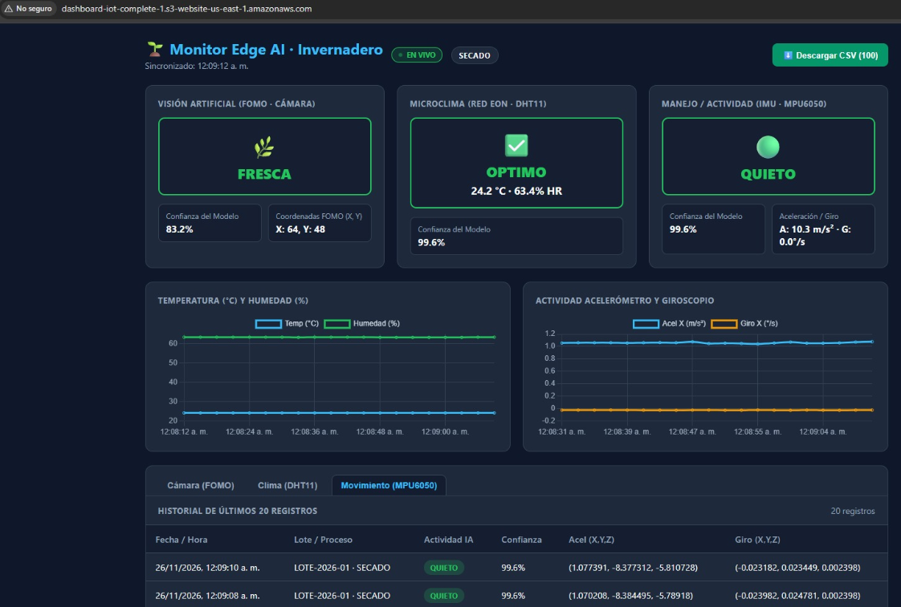

## 8 Alertas

Para notificar de forma inmediata cualquier anomalía climática, logística o fitosanitaria detectada por los modelos de Edge AI, se implementó un pipeline de mensajería sin servidores (*serverless*) basado en reglas SQL de **AWS IoT Core** conectadas a **Amazon SNS (Simple Notification Service)**.

* En amazon sns > ` temas` > `crear un tema` , las opciones que se usan son:
  
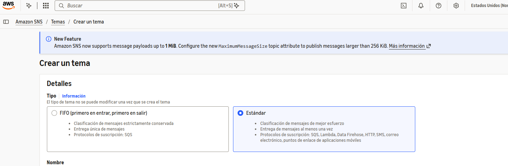

* Se ingresa un nombre  `ej: AlertasEdge`

* Se crea una suscipcion, luego se asigna el correo donde se enviaran las alertas.

Se debe confirmar el correo, Se verifica que el estado este en confirmado

en AWS IoT Core (Enrutamiento de mensajes > Reglas), se configuraron reglas con cláusulas WHERE para disparar alertas únicamente ante condiciones críticas y expresiones SQL CONCAT para construir mensajes legibles directamente desde el motor de reglas (sin requerir funciones Lambda intermedias), utilizando el rol de permisos LabRole:

| Alerta Monitoreada | Tópico MQTT | Condición de Disparo (`WHERE`) | Mensaje Generado (`CONCAT`) |
| :--- | :--- | :--- | :--- |
| **Estrés Térmico / Frío** | `esp32/values` | `model_temp = 'estres_termico' OR model_temp = 'baja_temp'` | `CONCAT('ALERTA CLIMA [', lote, ']: ', model_temp, ' detectado (', temperatura, ' °C) en ', device_id)` |
| **Movimiento / Volteo** | `esp32/movimiento` | `model_mov = 'transporte' OR model_mov = 'volteo_hojas'` | `CONCAT('ALERTA LOGISTICA [', lote, ']: Evento de ', model_mov, ' detectado en ', device_id)` |
| **Detección Fitosanitaria** | `esp32/imagen` | `estado_hoja = 'hongo' OR estado_hoja = 'seca'` | `CONCAT('ALERTA CULTIVO [', lote, ']: Hoja con ', estado_hoja, ' detectada (Confianza: ', confianza, ')')` |

## 9 Retos y Posibles Mejoras Futuras

Durante el desarrollo e integración del ecosistema Edge AI + AWS Cloud, se resolvieron los siguientes desafíos críticos:

* **Limitaciones de Memoria (SRAM / PSRAM) en Microcontroladores:**
  
  * Ejecutar inferencia de visión artificial (FOMO INT8) junto con la pila TLS/MQTT de AWS IoT Core y un servidor MCP HTTP local en el **ESP32-CAM** llevó la memoria al límite. Se resolvió mediante cuantización estricta (`INT8`), asignación dinámica en **PSRAM** para los *tensors* de imagen y el uso de búferes circulares FIFO de tamaño fijo (10 registros) para evitar fragmentación del *heap*.
    
* **Inconsistencia de Formatos de Tiempo entre Nodos:**
  
  * Mientras el nodo principal (`ESP32`) sincronizaba cadenas ISO-8601 vía NTP, el `ESP32-CAM` publicaba marcas de tiempo en enteros Unix (`epoch`). Esto generaba desorden cronológico en DynamoDB y errores en las gráficas; se solucionó estandarizando ambos flujos a nivel de backend (AWS Lambda) y cliente hacia la zona horaria local de Colombia (`UTC-5`).
    
  * En entornos de invernadero con iluminación variable, el modelo FOMO tiende a confundir texturas de fondo (sustrato, sombras o malla) con hojas enfermas (`hongo` o `seca`). Se mitigó implementando una alerta cruzada en el dashboard que exige correlación entre la detección visual y el riesgo climático (`riesgo_hongo` por alta humedad) antes de disparar una alerta crítica en pantalla.
 
Para escalar el sistema se proyectan las siguientes líneas de evolución:

1. **Almacenamiento de Evidencia Visual en Amazon S3:**
   
   * Configurar el `ESP32-CAM` para subir la captura JPEG (`Base64` o `HTTP PUT` prefirmado) a un bucket privado de S3 únicamente cuando la confianza de detección de `hongo` supere el `85%`, enlazando la URL de la imagen en DynamoDB para auditoría agronómica.
     
2. **Autenticación y Seguridad de API (Amazon Cognito + API Key):**

   * Proteger el endpoint público de API Gateway y el acceso al dashboard en S3 mediante **Amazon Cognito** o claves de API (`x-api-key`), restringiendo el acceso y las descargas históricas por rol de usuario.

3. **Reentrenamiento Continuo (MLOps en el Borde):**
   
   * Implementar un flujo automatizado donde los registros exportados en CSV y las capturas validadas por agrónomos alimenten directamente nuevos datasets en **Edge Impulse**, permitiendo actualizar los pesos `.tflite` mediante actualizaciones inalámbricas.
  
4. **Migración de *Polling* HTTP a WebSockets en Tiempo Real:**

   * Reemplazar el ciclo de consulta cada `2.5 segundos` en `index.html` por **AWS IoT Core over WebSockets** o **API Gateway WebSocket API**, reduciendo costos de invocación en Lambda y logrando latencia sub-segundo en las gráficas.
