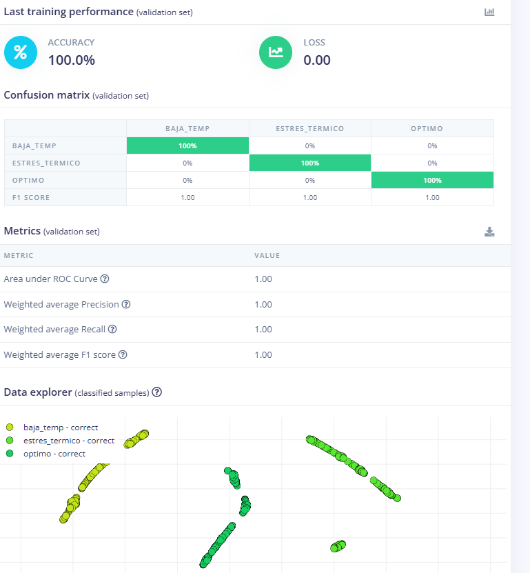

# CocaTrace Edge AI — Sistema de Trazabilidad y Monitoreo Inteligente

Sistema inteligente de monitoreo y trazabilidad que integra inteligencia artificial embebida (TinyML), computación en la nube con AWS y agentes conversacionales mediante MCP (Model Context Protocol).

Utiliza dos nodos físicos independientes basados en microcontroladores ESP32 que ejecutan tres modelos neuronales locales sin depender de conexión constante a internet: un nodo analiza condiciones climáticas (DHT11) y movimiento logístico (MPU6050) mediante modelos compilados con Edge Impulse EON, mientras que una ESP32-CAM realiza detección visual de plagas y estado de hojas en tiempo real con el algoritmo FOMO.

Los datos de inferencia viajan de forma segura por MQTT hacia AWS IoT Core, donde reglas SQL filtran anomalías críticas (estrés térmico, baja temperatura o presencia de hongos) para disparar notificaciones instantáneas por correo electrónico mediante Amazon SNS. Paralelamente, la telemetría histórica se almacena en DynamoDB y se visualiza en un panel web interactivo alojado en Amazon S3 con actualización cada 1.5 segundos.

Ambas placas alojan servidores HTTP JSON-RPC 2.0 directamente en su memoria RAM, permitiendo que el usuario consulte el estado actual del cultivo, historiales y alertas mediante lenguaje natural desde VS Code (GitHub Copilot Agent) sin servidores intermedios.

## Integrantes
* Valentina Arciniegas
* Davinson Tulande
* Carlos Daza
* Andres Coral

# Arquitectura 

1. **Capa Edge (Inferencia Local en Microcontroladores):**

* **Nodo Principal (`ESP32`):** Ejecuta dos modelos neuronales de Edge Impulse simultáneamente:
  
    * *Modelo Climático :* Clasifica temperatura (`optimo`, `baja_temp`, `estres_termico`) a 1 Hz con sensor DHT11.
  
    * *Modelo de Movimiento:* Clasifica estados logísticos (`reposo`, `transporte`, `volteo`) a 50 Hz con acelerómetro/giroscopio MPU6050.
  
    * *Nodo de Visión (`ESP32-CAM AI-Thinker`):* Ejecuta un modelo de detección de objetos **FOMO** para identificar el estado
 de las hojas (`hoja_sana`, `seca`, `hongo`) junto con sus coordenadas espaciales `(x, y)`.

2. **Capa Cloud & Alertas (AWS Serverless):**

* **AWS IoT Core:** Recepción segura mediante MQTT sobre TLS 1.2 (`esp32/values`, `esp32/movimiento`, `esp32/imagen`).
 
* **Reglas IoT + Amazon SNS:** Filtrado SQL en tiempo real para el disparo automático de alertas personalizadas por correo electrónico ante anomalías térmicas, manipulación brusca o detección de plagas.
  
* **Amazon DynamoDB + AWS Lambda + API Gateway**: Persistencia histórica de telemetría y exposición de endpoints REST para consulta unificada.
* **Amazon S3 (Dashboard Web):** Interfaz interactiva con actualización asíncrona cada 1.5 segundos, gráficas dinámicas (Chart.js) y exportación a CSV. 

3. **Ambas placas ESP32 alojan un servidor HTTP JSON-RPC 2.0 (`/mcp`) con búferes circulares en RAM (últimos 10 registros por modelo), permitiendo consultas en lenguaje natural directamente desde **VS Code (GitHub Copilot Agent)** sin intermediarios.**

## 1. Modelos de clasificación 

### 1.1 Humedad- Temperatura

Este modelo neuronal se entrena y compila con **Edge Impulse (EON Compiler)** para operar directamente sobre el microcontrolador **ESP32** (`tflite_learn_1171835_5`), permitiendo detectar anomalías térmicas en tiempo real sin depender de procesamiento en la nube. (sensor DHT11).Las metricas obtenidas son:

* **Precisión y Pérdida:** El modelo alcanzó un **100.0 % de exactitud (*Accuracy*)** y una **pérdida (*Loss*) de 0.00** sobre el conjunto de validación, demostrando una convergencia óptima sin errores de clasificación.
  
* **Matriz de Confusión:** Las tres clases (`baja_temp`, `estres_termico` y `optimo`) obtuvieron un **F1-Score de 1.00** (100 % de aciertos en la diagonal principal y 0 % de falsos positivos/negativos entre categorías).
  
* **Separabilidad de Características (*Data Explorer*):** En la proyección del espacio de características, los clústeres de cada estado térmico aparecen claramente diferenciados y sin solapamiento, lo que explica el **AUC-ROC de 1.00** y garantiza inferencias determinísticas y estables en el ESP32.

El dataset de entrenamiento y validación se encuentra en `

## Dashboard

El Monitor Edge IA - Cocatrace es una interfaz web de monitoreo en tiempo real diseñada para visualizar y analizar las condiciones de un cultivo durante su proceso de germinación y desarrollo. El sistema integra información proveniente de diferentes dispositivos IoT y modelos de inteligencia artificial (IA), permitiendo supervisar tres aspectos fundamentales:

* Visión artificial (FOMO - ESP32-CAM): permite visualizar las clasificaciones sobre el estado de las hojas.
* Monitoreo de microclima (DHT11): permite consultar las condiciones ambientales del cultivo, principalmente temperatura y humedad relativa.
* Monitoreo de movimiento (MPU6050): permite analizar la actividad, aceleración y giros registrados por el sensor inercial.

La información es consultada mediante una API desplegada en AWS API Gateway, permitiendo actualizar automáticamente los indicadores, gráficas e historiales de registros.

Esta herramienta visual facilita:

* Consultar el estado actual de las hojas mediante visión artificial.
* Identificar condiciones ambientales que puedan representar riesgos para el cultivo.
* Supervisar movimientos, vibraciones y actividad física del sistema.
* Visualizar el comportamiento histórico de las variables mediante gráficas.
* Consultar los registros históricos de cada dispositivo.
* Exportar la información recopilada en archivos CSV.
* Generar alertas visuales cuando se identifican condiciones de riesgo relacionadas con hongos.

El panel principal está dividido en tres tarjetas que presentan la información brindada por los modelos de IA.

### Visión Artificial (FOMO - Cámara)

Muestra los resultados obtenidos mediante el modelo FOMO (Faster Objects, More Objects) de visión artificial, donde se muestra: clasificación del estado de la hoja, confianza de la predicción del modelo, coordenadas X e Y asociadas a la detección y los indicadores visuales mediante iconos y colores según el estado identificado.

### Clima (Red EON - DHT11)

Presenta las condiciones ambientales registradas por el sensor DHT11, donde se muestra: temperatura en grados Celsius (°C), humedad relativa (% HR), clasificación del estado ambiental realizada por el modelo de IA, nivel de confianza de la predicción, proceso actual del cultivo.

### Manejo / Actividad (IMU - MPU6050)

Presenta los datos relacionados con el movimiento del sistema, donde se muestra: clasificación de la actividad mediante IA, confianza del modelo, valores de aceleración en los ejes X, Y y Z, valores de velocidad angular en los ejes X, Y y Z, magnitud resultante de aceleración y giro.

Además el monitor incorpora dos gráficas dinámicas que son:

### Gráfica de temperatura y humedad

Permite observar el comportamiento histórico de Temperatura (°C) y Humedad relativa (%).

### Gráfica de acelerómetro y giroscopio

Permite visualizar la evolución de la Aceleración en el eje X (m/s²) y la Velocidad angular en el eje X (°/s).

Las gráficas se actualizan automáticamente con los nuevos datos recibidos desde la API, sin necesidad de recargar la página.

### Historial de registros

La interfaz cuenta con una tabla dinámica que permite consultar los registros históricos de cada subsistema mediante tres pestañas:

* Cámara (FOMO): Fecha, cámara, lote, tipo de hoja, confianza y coordenadas.
* Clima (DHT11):	Fecha, lote, proceso, estado climático, temperatura, humedad y confianza.
* Movimiento (MPU6050):	Fecha, lote, proceso, actividad detectada, confianza, aceleración y giro.

Cada pestaña actualiza dinámicamente los encabezados y el contenido de la tabla según el tipo de información seleccionado. Los estados se representan mediante etiquetas de colores para facilitar su interpretación.

### Exportación de información CSV

El botón Descargar CSV permite exportar los registros históricos del subsistema seleccionado, teniendo presente las siguientes características:

* Consulta hasta 100 registros desde la API.
* Genera un archivo CSV con los encabezados correspondientes.
* Convierte las fechas a un formato legible.
* Genera automáticamente el nombre del archivo según el subsistema y la fecha de descarga, como por ejemplo "registros_camara_2026-11-26.csv"

Por último, el Monitor Edge IA - Cocatrace proporciona una visualización centralizada de la información generada por los diferentes dispositivos IoT y modelos de IA. Su implementación permite integrar visión artificial, monitoreo ambiental y análisis de movimiento en una única interfaz web, facilitando la supervisión del cultivo, la identificación de posibles condiciones de riesgo y la consulta de información histórica para el análisis del comportamiento del sistema.

